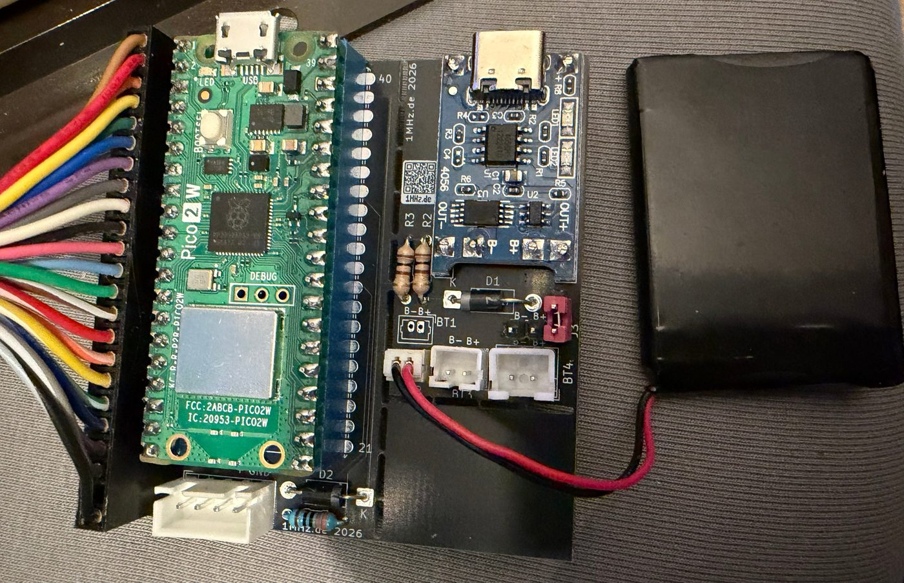
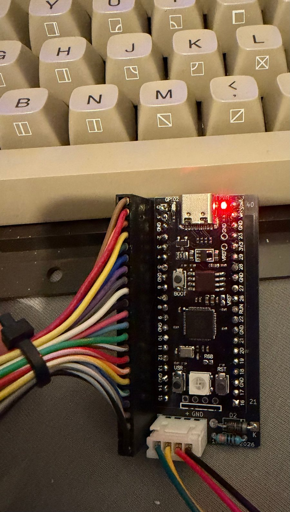

# CBM2 Keyboard

*English version: [README.md](README.md)*

Mit dem **CBM2 Keyboard** läuft eine Tastatur der **CBM-II-Serie** (Commodore 500/600/700, hier die
US/ASCII-Version aus dem 610) am **Commodore 64** – ohne eigenes Kernal und ohne Eingriff in den C64.
Ein Raspberry Pi Pico liest die Tastatur aus und schickt die Tasten an einen
[Pico64 Keyboard](https://github.com/do2mad/pico64-keyboard)-Adapter im C64 – per **Kabel** oder
**Bluetooth**. An einem Computer arbeitet er zusätzlich als **USB-Tastatur** (MiSTer, PC, Mac).

```
CBM-II-Tastatur ──22 Leitungen──> Pico ──Kabel (4-pol.) oder Bluetooth──> Pico64 Keyboard im C64
                                    └────────────USB─────────────────────> MiSTer / PC / Mac
```



## Zwei Varianten

| | **Pico 2 W** (RP2350) | **RP2040** (YD-RP2040 oder Pico 1) |
|---|---|---|
| Verbindung zum C64 | Kabel **oder** Bluetooth | nur Kabel |
| USB-Tastatur | ja | ja |
| Akku | ja, mit Spannungsanzeige | möglich; Spannung nur mit Teiler an GP26 |
| Firmware | `cbm2-keyboard_pico2w_v…uf2` | `cbm2-keyboard_rp2040_v…uf2` |

Beide Varianten sitzen auf derselben schwarzen Platine. Die Firmware erkennt das Board nicht selbst –
bitte die passende Datei wählen. Eine falsche Datei nimmt der Pico gar nicht erst an.



**Zum Pico64 passt dessen Firmware ab 0.13.1** – für die schnelle Kabelverbindung brauchen beide
mindestens Pico64 0.13.1 und CBM2 0.4.2.

## Anschließen

### Kabel zum Pico64 (empfohlen)

JST-XH 4-polig, 1:1 verdrahtet:

| Pin | Funktion |
|---|---|
| 1 | Daten (CBM2 GP28 → 330 Ω → Pico64 GP17) |
| 2 | Kabel-Erkennung (GP22, im Kabel auf GND) |
| 3 | Strom (Pico64 VSYS → 1N5817 → VSYS) |
| 4 | GND |

Ist das Kabel gesteckt, ist Bluetooth aus und der Strom kommt vom C64. Die Verzögerung liegt bei etwa
3–5 ms – Spiele wie Frogger laufen wie mit der Originaltastatur.

### Bluetooth (nur Pico 2 W)

Ohne Kabel sucht der Pico 2 W selbst einen Pico64 (oder BT-64 / Blue-64) und verbindet sich ohne
Kopplung. Nach einer Minute ohne Erfolg sucht er langsamer, um Strom zu sparen.

### USB

An einem Computer meldet sich der Pico als **USB-Tastatur** mit Konsole – aber nur, solange keine
Verbindung zum C64 besteht. Die Ausgabe passt man auf das Zielsystem an (wird gespeichert):

| Tasten | Ausgabe |
|---|---|
| CE + F1 | MiSTer (CE allein = F11, das OSD-Menü) |
| CE + F3 | PC, deutsches Layout |
| CE + F5 | PC, US-Layout |
| CE + F7 | Mac, deutsches Layout |
| CE + F8 | Mac, US-Layout |

### Akku

Ein LiPo-Akku (z. B. 650 mAh) über das Lademodul **4056 + DW01**: Akku an B+/B−, **OUT+** über den
Schalter-Jumper und eine 1N5817 an VSYS, **GND an OUT−** (nicht an B−). Ladestrom des Moduls mit R3
an den Akku anpassen (bei 650 mAh R3 = 2,4 kΩ statt 1,2 kΩ). Geladen wird über die USB-C-Buchse des
Lademoduls.

## LED

| LED | Bedeutung |
|---|---|
| kurzer Blitz jede Sekunde | sucht eine Verbindung |
| kurzer Blitz alle 4 Sekunden | verbunden (Kabel oder Bluetooth) |

## Version und Akku abfragen: C= + F10

**C= + F10** tippt Version und Versorgung auf den Bildschirm, zum Beispiel:

| Situation | Text |
|---|---|
| Pico 2 W am Akku | `cbm2 v0.4.4 akku 3.92v 80%` |
| Pico 2 W an USB / am Kabel | `cbm2 v0.4.4 usb 4.78v` / `cbm2 v0.4.4 kabel 4.70v` |
| RP2040 am Kabel | `cbm2 v0.4.4 rp2040 kabel` |
| RP2040 mit Teiler am Akku | `cbm2 v0.4.4 rp2040 akku 3.92v 80%` |
| RP2040 ohne Teiler | `cbm2 v0.4.4 rp2040` |

## Tastenbelegung

Die Tasten werden **nach Zeichen** umgesetzt – es kommt an, was auf der Kappe steht.

| CBM-II | C64 |
|---|---|
| Buchstaben | Buchstaben, mit SHIFT Grafikzeichen |
| 1–0 mit SHIFT | ! @ # $ % ↑ & * ( ) wie aufgedruckt |
| ; : ' " , < . > / ? = + - [ ] | wie aufgedruckt |
| ← / £ | ←, mit SHIFT £ |
| π | π |
| F1–F8 | F1–F8 (F2 = SHIFT + F1 usw.) |
| F9 | tippt `LOAD"*",8,1` und RETURN |
| F10 | tippt `RUN` und RETURN |
| C= + F10 | Version und Versorgung |
| Cursortasten | CRSR |
| CLR/HOME, INS/DEL, RUN/STOP | gleich |
| OFF/RVS | RVS ON (CTRL + 9), mit SHIFT RVS OFF (CTRL + 0) |
| NORM/GRAPH | Zeichensatz wechseln (SHIFT + C=) |
| ESC | ← |
| RETURN, ENTER | RETURN |
| Ziffernblock | Ziffern und + - * / . ?, 00 tippt zwei Nullen |
| CE | **RESTORE** |
| CTRL / C= + Ziffer | Ziffer bleibt Ziffer (Farben, RVS) |
| SHIFT, SHIFT LOCK, CTRL, C= | gleich |

## Firmware aufspielen

Am einfachsten auf der [Flash-Seite](https://1mhz.de/Pico64/) – direkt aus Chrome oder Edge. Oder die
passende UF2-Datei aus dem [neuesten Release](https://github.com/do2mad/cbm2-keyboard/releases/latest)
herunterladen, den Pico in den Bootloader bringen und die Datei auf das Laufwerk ziehen.

- **Pico 2 W:** BOOTSEL gedrückt halten und USB einstecken.
- **YD-RP2040:** BOOT gedrückt halten und kurz RST drücken (oder BOOT halten und USB einstecken).

Der Pico kann dabei eingebaut bleiben; der C64 sollte ausgeschaltet sein.

## Für Selbstbauer: Anschlüsse am Pico

| Pico | Funktion |
|---|---|
| GP0–GP5 | Tastatur Zeilen C0–C5 |
| GP6–GP13 | Tastatur Spalten R7 … R0 |
| GP14–GP21 | Tastatur Spalten R15 … R8 |
| GP22 | Kabel-Erkennung (im Kabel auf GND) |
| GP28 | Daten zum Pico64 (über 330 Ω an dessen GP17) |
| GP26 | nur RP2040: Spannungsteiler Vin – 100 kΩ – GP26 – 100 kΩ – GND (optional) |
| VSYS / Vin | 5 V vom Kabel bzw. Akku, jeweils über eine 1N5817 |

Die Tastatur hat einen 23-poligen Stecker (2,54 mm, 22 Kontakte belegt, ein Kodierplatz).

**Platine:** Gerber-Dateien, Stückliste und Fotos in [hardware/](hardware/README.de.md).

## Konsole

Über USB (115200 Baud) gibt es eine Konsole: `d` Tastenlog an/aus, `!s` Status, `!r` Bluetooth neu
suchen, `!v` Spannung, `!u` bzw. `!u0`…`!u4` USB-Ausgabe wählen.

## Firmware selbst bauen

Raspberry Pi Pico SDK 2.2.0 (mit den Submodulen `cyw43-driver`, `btstack`, `tinyusb`), CMake, Arm-GNU-Toolchain:

```sh
cd firmware
cmake -S . -B build -DPICO_SDK_PATH=/pfad/zu/pico-sdk                          # Pico 2 W
cmake --build build                    # -> build/cbm2_keyboard.uf2
cmake -S . -B build-rp2040 -DPICO_BOARD=pico -DPICO_SDK_PATH=/pfad/zu/pico-sdk  # RP2040
cmake --build build-rp2040
```

USB-Kennung: vorerst die Test-Kennung `1209:0001` von pid.codes.

## Forum

Fragen, Fotos, Erfahrungen: der Thread im Retro-Forum
[1mhz.de – Pico64-Keyboard, SPL BT-64 oder Blue-64 Tastaturadapter](https://1mhz.de/forum/thread/8761-pico64-keyboard-spl-bt-64-oder-blue-64-tastaturadapter/).
Fehlerberichte und Wünsche gern auch als GitHub-Issue.

## Lizenz

- Firmware © 2026 Martin Oswald – [1mhz.de](https://1mhz.de), [MIT-Lizenz](LICENSE)
- Hardware (Platine) © 2026 Martin Oswald, [CC BY-NC-SA 4.0](LICENSE-HARDWARE.md) – nicht-kommerziell
- Nutzt Raspberry Pi Pico SDK, TinyUSB, BTstack und den CYW43-Treiber – siehe [NOTICE](NOTICE)

Änderungen: [CHANGELOG.md](CHANGELOG.md)

Commodore ist eine Marke ihrer jeweiligen Inhaber. Dieses Projekt steht in keiner Verbindung zu
ihnen oder zu Raspberry Pi Ltd.
