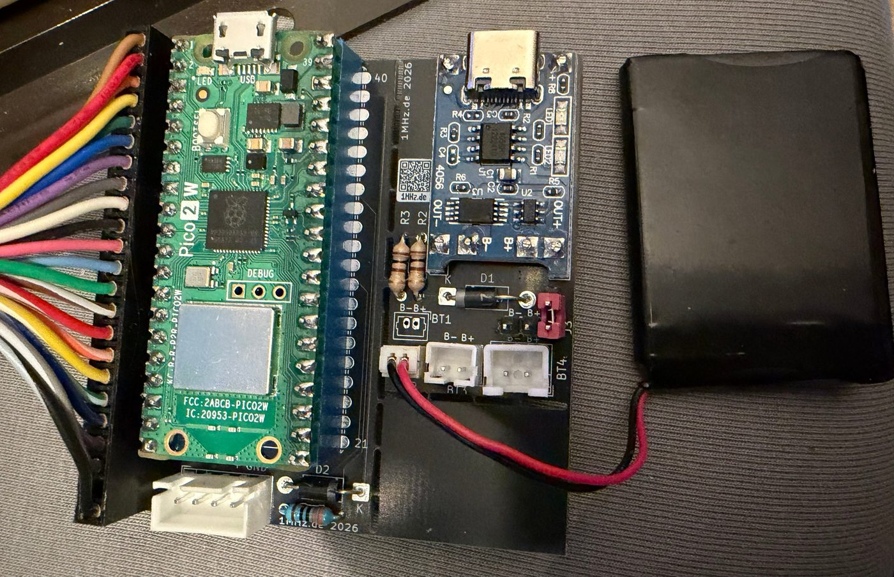
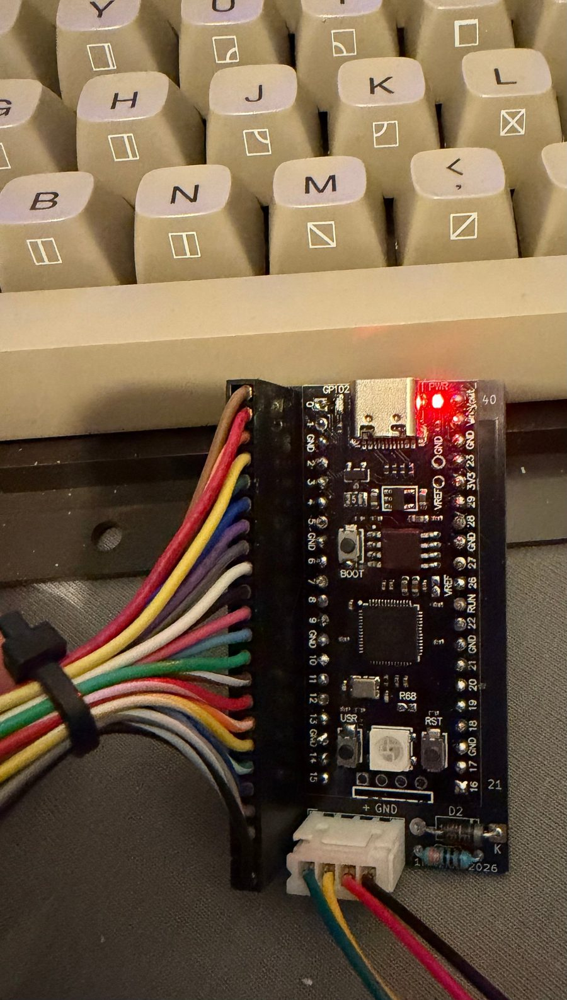

# CBM2 Keyboard

> 🇩🇪 **Deutsche Anleitung: [README.de.md](README.de.md)**

The **CBM2 Keyboard** lets you use a keyboard from the **CBM-II series** (Commodore 500/600/700, here
the US/ASCII version from a 610) on a **Commodore 64** – no custom kernal and no changes to the C64.
A Raspberry Pi Pico scans the keyboard and sends the keys to a
[Pico64 Keyboard](https://github.com/do2mad/pico64-keyboard) adapter inside the C64 – by **cable** or
**Bluetooth**. On a computer it also works as a **USB keyboard** (MiSTer, PC, Mac).

```
CBM-II keyboard ──22 lines──> Pico ──cable (4-pin) or Bluetooth──> Pico64 Keyboard in the C64
                                └────────────USB─────────────────> MiSTer / PC / Mac
```



## Two variants

| | **Pico 2 W** (RP2350) | **RP2040** (YD-RP2040 or Pico 1) |
|---|---|---|
| Link to the C64 | cable **or** Bluetooth | cable only |
| USB keyboard | yes | yes |
| Battery | yes, with voltage readout | possible; voltage only with a divider on GP26 |
| Firmware | `cbm2-keyboard_pico2w_v…uf2` | `cbm2-keyboard_rp2040_v…uf2` |

Both variants use the same black PCB. The firmware does not detect the board by itself – please pick
the matching file. The Pico simply refuses a file for the wrong chip.



**The Pico64 needs firmware 0.13.1 or newer** – the fast cable link needs at least Pico64 0.13.1 and
CBM2 0.4.2.

## Connecting

### Cable to the Pico64 (recommended)

JST-XH 4-pin, wired 1:1:

| Pin | Function |
|---|---|
| 1 | Data (CBM2 GP28 → 330 Ω → Pico64 GP17) |
| 2 | Cable detect (GP22, tied to GND in the cable) |
| 3 | Power (Pico64 VSYS → 1N5817 → VSYS) |
| 4 | GND |

With the cable plugged in, Bluetooth is off and power comes from the C64. Latency is about 3–5 ms –
games like Frogger play just like with the original keyboard.

### Bluetooth (Pico 2 W only)

Without the cable the Pico 2 W looks for a Pico64 (or BT-64 / Blue-64) by itself and connects without
pairing. After a minute without success it scans more slowly to save power.

### USB

On a computer the Pico shows up as a **USB keyboard** with a console – but only while there is no link
to the C64. Choose the output for the target system (it is saved):

| Keys | Output |
|---|---|
| CE + F1 | MiSTer (CE alone = F11, the OSD menu) |
| CE + F3 | PC, German layout |
| CE + F5 | PC, US layout |
| CE + F7 | Mac, German layout |
| CE + F8 | Mac, US layout |

### Battery

A LiPo cell (e.g. 650 mAh) via the **4056 + DW01** charger module: cell to B+/B−, **OUT+** through the
switch jumper and a 1N5817 to VSYS, **GND to OUT−** (not B−). Match the charge current to the cell with
R3 (for 650 mAh use 2.4 kΩ instead of 1.2 kΩ). Charging is done through the module's USB-C socket.

## LED

| LED | Meaning |
|---|---|
| short flash every second | looking for a connection |
| short flash every 4 seconds | connected (cable or Bluetooth) |

## Version and battery: C= + F10

**C= + F10** types version and power supply on the screen, for example:

| Situation | Text |
|---|---|
| Pico 2 W on battery | `cbm2 v0.4.4 akku 3.92v 80%` |
| Pico 2 W on USB / cable | `cbm2 v0.4.4 usb 4.78v` / `cbm2 v0.4.4 kabel 4.70v` |
| RP2040 on cable | `cbm2 v0.4.4 rp2040 kabel` |
| RP2040 with divider on battery | `cbm2 v0.4.4 rp2040 akku 3.92v 80%` |
| RP2040 without divider | `cbm2 v0.4.4 rp2040` |

(`akku` = battery, `kabel` = cable.)

## Key mapping

Keys are translated **by character** – you get what is printed on the keycap.

| CBM-II | C64 |
|---|---|
| Letters | letters, with SHIFT graphics characters |
| 1–0 with SHIFT | ! @ # $ % ↑ & * ( ) as printed |
| ; : ' " , < . > / ? = + - [ ] | as printed |
| ← / £ | ←, with SHIFT £ |
| π | π |
| F1–F8 | F1–F8 (F2 = SHIFT + F1 etc.) |
| F9 | types `LOAD"*",8,1` and RETURN |
| F10 | types `RUN` and RETURN |
| C= + F10 | version and power supply |
| Cursor keys | CRSR |
| CLR/HOME, INS/DEL, RUN/STOP | same |
| OFF/RVS | RVS ON (CTRL + 9), with SHIFT RVS OFF (CTRL + 0) |
| NORM/GRAPH | switch character set (SHIFT + C=) |
| ESC | ← |
| RETURN, ENTER | RETURN |
| Keypad | digits and + - * / . ?, 00 types two zeros |
| CE | **RESTORE** |
| CTRL / C= + digit | digit stays a digit (colours, RVS) |
| SHIFT, SHIFT LOCK, CTRL, C= | same |

## Installing the firmware

Easiest on the [flash page](https://1mhz.de/Pico64/) – directly from Chrome or Edge. Or download the
matching UF2 file from the [latest release](https://github.com/do2mad/cbm2-keyboard/releases/latest),
put the Pico into bootloader mode and drag the file onto the drive.

- **Pico 2 W:** hold BOOTSEL and plug in USB.
- **YD-RP2040:** hold BOOT and briefly press RST (or hold BOOT and plug in USB).

The Pico can stay installed; the C64 should be switched off.

## For builders: Pico pins

| Pico | Function |
|---|---|
| GP0–GP5 | keyboard rows C0–C5 |
| GP6–GP13 | keyboard columns R7 … R0 |
| GP14–GP21 | keyboard columns R15 … R8 |
| GP22 | cable detect (tied to GND in the cable) |
| GP28 | data to the Pico64 (through 330 Ω to its GP17) |
| GP26 | RP2040 only: divider Vin – 100 kΩ – GP26 – 100 kΩ – GND (optional) |
| VSYS / Vin | 5 V from cable or battery, each through a 1N5817 |

The keyboard has a 23-position connector (2.54 mm, 22 contacts used, one key position).

**PCB:** Gerber files, parts list and photos in [hardware/](hardware/).

## Console

Over USB (115200 baud) there is a console: `d` key log on/off, `!s` status, `!r` rescan Bluetooth,
`!v` voltage, `!u` or `!u0`…`!u4` choose USB output.

## Building the firmware

Raspberry Pi Pico SDK 2.2.0 (with the submodules `cyw43-driver`, `btstack`, `tinyusb`), CMake, Arm GNU toolchain:

```sh
cd firmware
cmake -S . -B build -DPICO_SDK_PATH=/path/to/pico-sdk                          # Pico 2 W
cmake --build build                    # -> build/cbm2_keyboard.uf2
cmake -S . -B build-rp2040 -DPICO_BOARD=pico -DPICO_SDK_PATH=/path/to/pico-sdk  # RP2040
cmake --build build-rp2040
```

USB ID: for now the pid.codes test ID `1209:0001`.

## Forum

Questions, photos, experiences: the thread on the retro forum
[1mhz.de – Pico64-Keyboard, SPL BT-64 oder Blue-64 Tastaturadapter](https://1mhz.de/forum/thread/8761-pico64-keyboard-spl-bt-64-oder-blue-64-tastaturadapter/)
(German, English posts welcome). Bug reports and wishes also as GitHub issues.

## Licence

- Firmware © 2026 Martin Oswald – [1mhz.de](https://1mhz.de), [MIT License](LICENSE)
- Hardware (PCB) © 2026 Martin Oswald, [CC BY-NC-SA 4.0](LICENSE-HARDWARE.md) – non-commercial
- Uses the Raspberry Pi Pico SDK, TinyUSB, BTstack and the CYW43 driver – see [NOTICE](NOTICE)

Changes: [CHANGELOG.md](CHANGELOG.md)

Commodore is a trademark of its respective owners. This project is not affiliated with them or
with Raspberry Pi Ltd.
