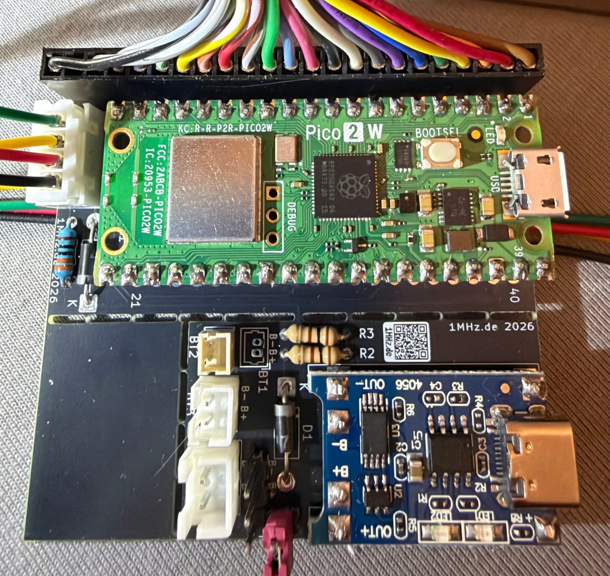
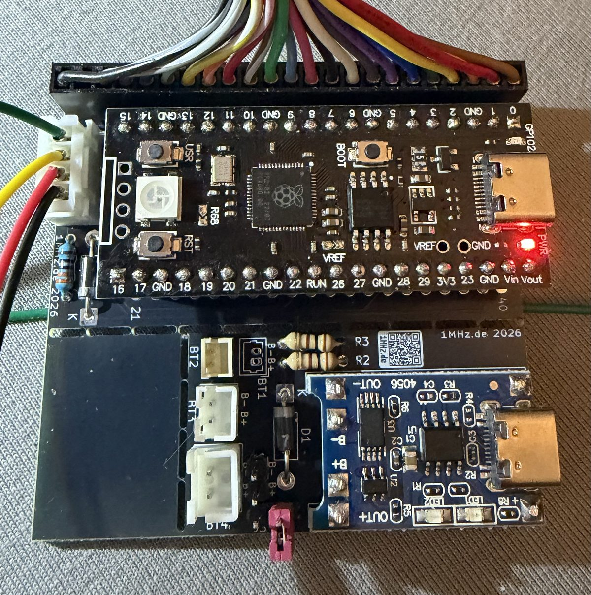
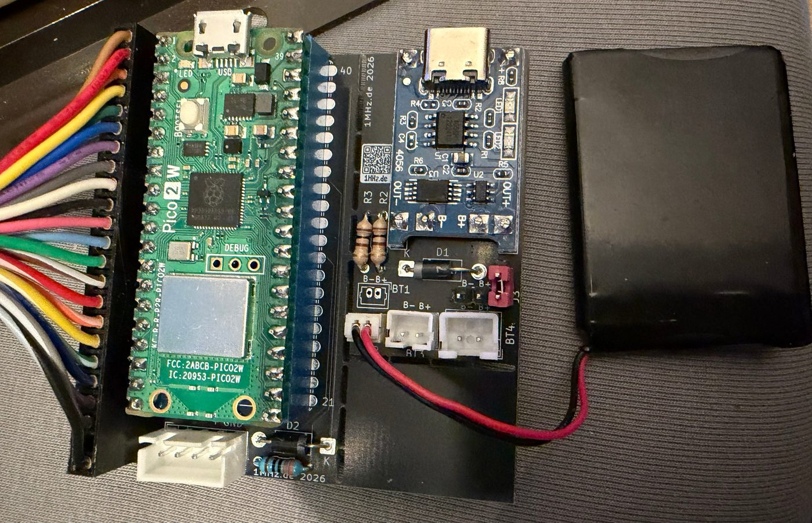
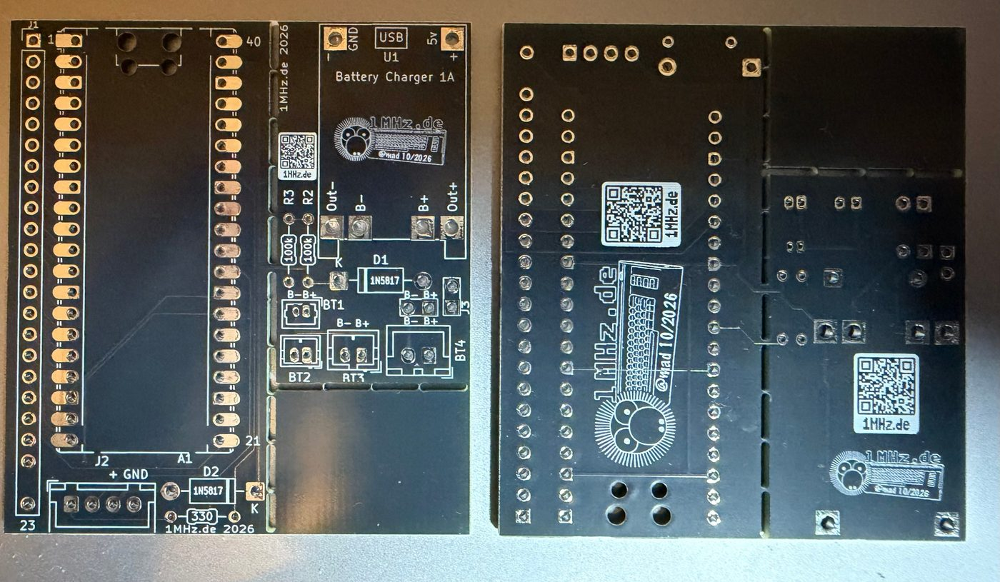

# Hardware (Platine)

[English](README.md)

Platine für das **CBM2 Keyboard**: Raspberry Pi **Pico 2 W** oder **YD-RP2040**, der 23-polige
Stecker der CBM-II-Tastatur, die Buchse für das Kabel zum Pico64 und – wer kabellos will – Platz für
ein Lademodul und einen LiPo-Akku. 56 × 62 mm, 2 Lagen, 1,6 mm, nur bedrahtete Bauteile.
Unter der Antenne des Pico 2 W hat die Platine einen Ausschnitt (besserer Funkempfang).

| | |
|---|---|
|  |  |
| mit Pico 2 W (Kabel oder Bluetooth) | mit YD-RP2040 (nur Kabel) |
|  |  |
| Pico 2 W mit Lademodul und Akku | unbestückt, Ober- und Unterseite |

## Dateien

| Datei | |
|---|---|
| [gerber/cbm2-keyboard-gerber-v1.0.zip](gerber/cbm2-keyboard-gerber-v1.0.zip) | Gerber- und Bohrdaten für den Platinenhersteller |
| [CBM2-Keyboard-bom.csv](CBM2-Keyboard-bom.csv) | Stückliste |

## Bauteile

| Anzahl | Bauteil | |
|---|---|---|
| 1 | Raspberry Pi Pico 2 W **oder** YD-RP2040 | A1, aufgelötet oder gesteckt |
| 1 | Stiftleiste 1 × 23, 2,54 mm | J1, Stecker der CBM-II-Tastatur (Pin 22 = Kodierplatz) |
| 1 | JST-XH-Buchse 4-polig (B4B-XH-A) | J2, Kabel zum Pico64 |
| 1 | Widerstand 330 Ω | R1, Datenleitung GP28 |
| 2 | Schottky-Diode 1N5817 | D2 Strom vom Kabel, D1 Strom vom Akku |
| 2 | Widerstand 100 kΩ | R2, R3 – *optional*, Spannungsteiler an GP26 (Akkuanzeige beim RP2040) |

Nur für den **Akkubetrieb**:

| Anzahl | Bauteil | |
|---|---|---|
| 1 | Lademodul TP4056 mit USB-C (4056 + DW01 + 8205A) | U1 |
| 1 | Stiftleiste 2-polig + Jumper | J3, Akku ein/aus |
| 1 | Akkubuchse – **eine** davon: | BT1 PicoBlade 1,25 mm · BT2 JST-ZH 1,5 mm · BT3 JST-PH 2,0 mm · BT4 JST-XH 2,5 mm · J4 Stiftleiste 2,54 mm |
| 1 | LiPo-Akku 3,7 V, z. B. 650 mAh | |

Beim Lademodul den Ladestrom an den Akku anpassen: R3 auf dem Modul bei 650 mAh 2,4 kΩ statt 1,2 kΩ.
GND der Schaltung hängt an **OUT−** des Moduls (nicht an B−), damit der Tiefentladeschutz greift.

## Anschlüsse

| Pico | Funktion |
|---|---|
| GP0–GP5 | Tastatur Zeilen C0–C5 |
| GP6–GP13 | Tastatur Spalten R7 … R0 |
| GP14–GP21 | Tastatur Spalten R15 … R8 |
| GP22 | Kabel-Erkennung (J2 Pin 2, im Kabel auf GND) |
| GP28 | Daten zum Pico64 (über R1 330 Ω an J2 Pin 1) |
| GP26 | Spannungsteiler VSYS – R2 – GP26 – R3 – GND |
| VSYS | über D2 vom Kabel (J2 Pin 3) und über D1 vom Akku |

**Kabel zum Pico64** (JST-XH 4-polig, 1:1): 1 Daten, 2 Erkennung, 3 Strom, 4 GND – passt auf die
Buchse J3 der [Pico64-Platine V2](https://github.com/do2mad/pico64-keyboard/tree/main/hardware).

## Lizenz

CC BY-NC-SA 4.0, siehe [../LICENSE-HARDWARE.md](../LICENSE-HARDWARE.md).
