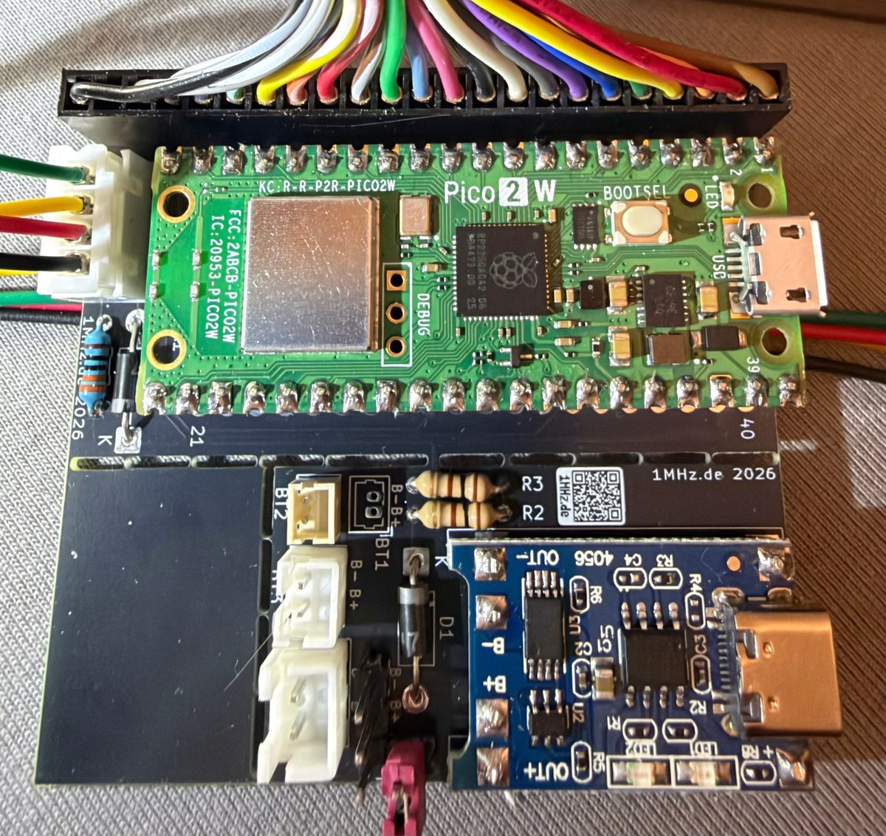
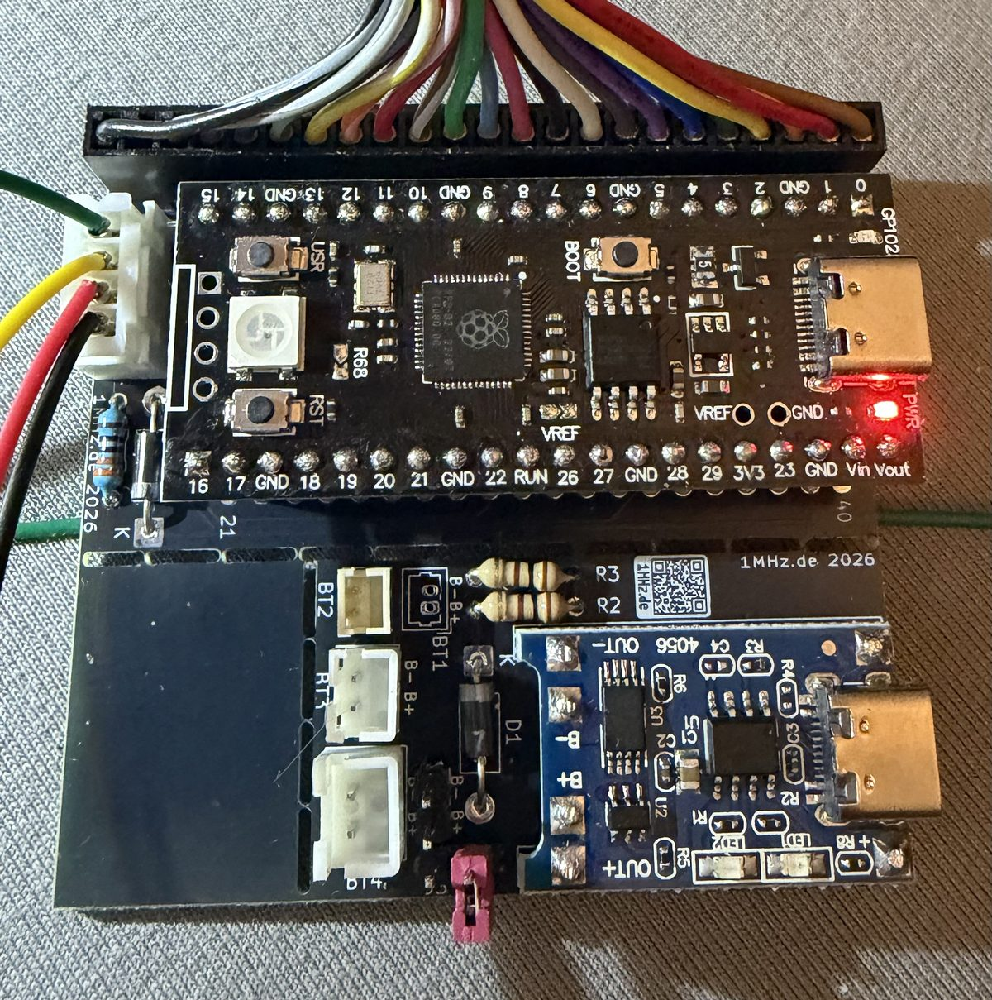
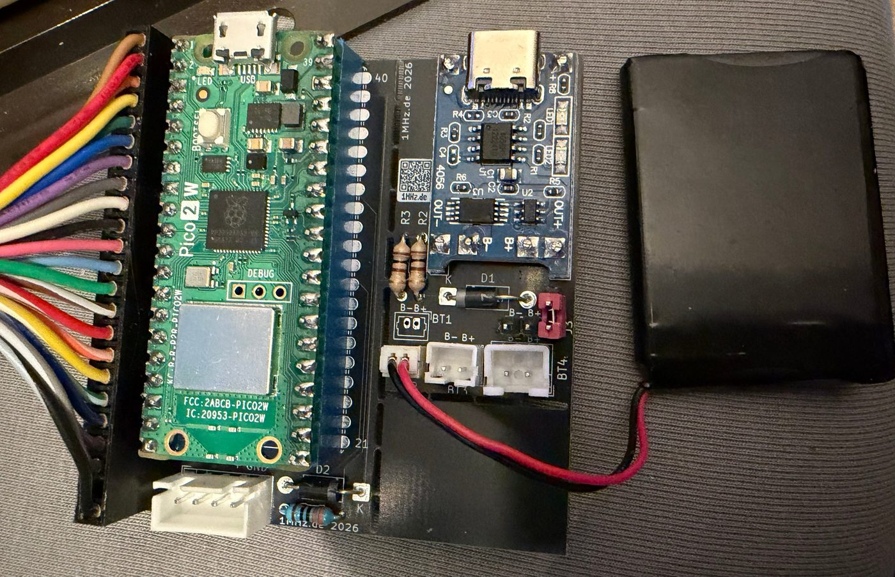
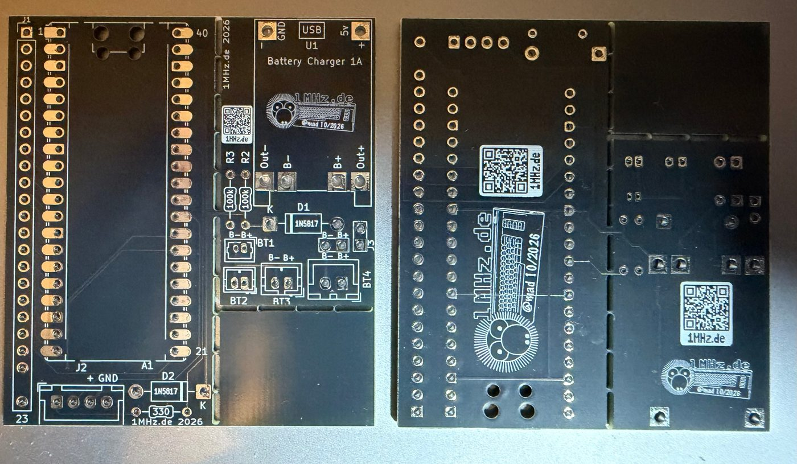

# Hardware (PCB)

[Deutsch](README.de.md)

PCB for the **CBM2 Keyboard**: a Raspberry Pi **Pico 2 W** or **YD-RP2040**, the 23-pin plug of the
CBM-II keyboard, the socket for the cable to the Pico64 and – if you want to go wireless – room for a
charger module and a LiPo cell. 56 × 62 mm, 2 layers, 1.6 mm, through-hole parts only.

| | |
|---|---|
|  |  |
| with Pico 2 W (cable or Bluetooth) | with YD-RP2040 (cable only) |
|  |  |
| Pico 2 W with charger module and battery | bare, top and bottom |

## Files

| File | |
|---|---|
| [gerber/cbm2-keyboard-gerber-v1.0.zip](gerber/cbm2-keyboard-gerber-v1.0.zip) | Gerber and drill files for the PCB maker |
| [CBM2-Keyboard-bom.csv](CBM2-Keyboard-bom.csv) | parts list |

## Parts

| Qty | Part | |
|---|---|---|
| 1 | Raspberry Pi Pico 2 W **or** YD-RP2040 | A1, soldered or plugged in |
| 1 | Male header 1 × 23, 2.54 mm | J1, plug of the CBM-II keyboard (pin 22 = key) |
| 1 | JST-XH socket 4-pin (B4B-XH-A) | J2, cable to the Pico64 |
| 1 | Resistor 330 Ω | R1, data line GP28 |
| 2 | Schottky diode 1N5817 | D2 power from the cable, D1 power from the battery |
| 2 | Resistor 100 kΩ | R2, R3 – *optional*, voltage divider on GP26 (battery readout on the RP2040) |

Only for **battery operation**:

| Qty | Part | |
|---|---|---|
| 1 | TP4056 charger module with USB-C (4056 + DW01 + 8205A) | U1 |
| 1 | 2-pin header + jumper | J3, battery on/off |
| 1 | Battery socket – **one** of: | BT1 PicoBlade 1.25 mm · BT2 JST-ZH 1.5 mm · BT3 JST-PH 2.0 mm · BT4 JST-XH 2.5 mm · J4 pin header 2.54 mm |
| 1 | LiPo cell 3.7 V, e.g. 650 mAh | |

Match the charge current to the cell: R3 on the module 2.4 kΩ instead of 1.2 kΩ for 650 mAh.
Circuit GND is connected to **OUT−** of the module (not B−), so the over-discharge protection works.

## Pins

| Pico | Function |
|---|---|
| GP0–GP5 | keyboard rows C0–C5 |
| GP6–GP13 | keyboard columns R7 … R0 |
| GP14–GP21 | keyboard columns R15 … R8 |
| GP22 | cable detect (J2 pin 2, tied to GND in the cable) |
| GP28 | data to the Pico64 (through R1 330 Ω to J2 pin 1) |
| GP26 | voltage divider VSYS – R2 – GP26 – R3 – GND |
| VSYS | through D2 from the cable (J2 pin 3) and through D1 from the battery |

**Cable to the Pico64** (JST-XH 4-pin, 1:1): 1 data, 2 detect, 3 power, 4 GND – fits socket J3 of
the [Pico64 PCB V2](https://github.com/do2mad/pico64-keyboard/tree/main/hardware).

## Licence

CC BY-NC-SA 4.0, see [../LICENSE-HARDWARE.md](../LICENSE-HARDWARE.md).
